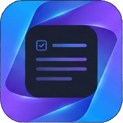
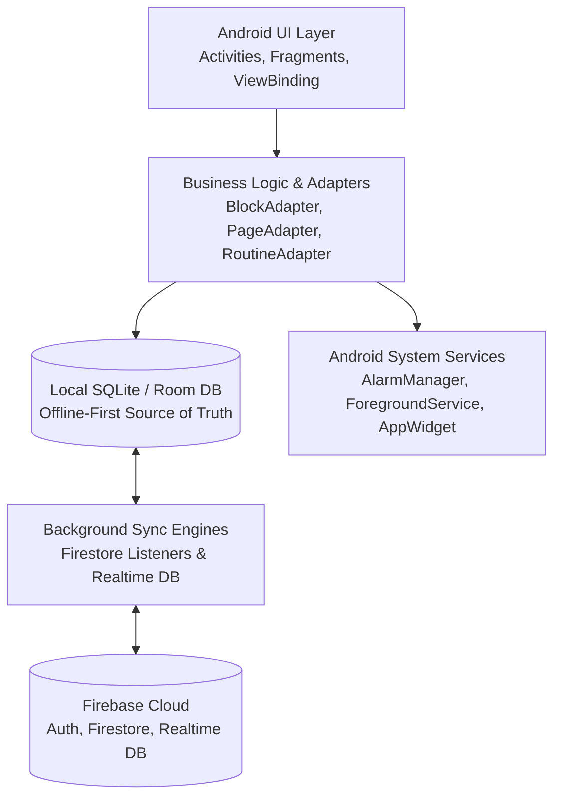

# MorphNote 📝⚡

<p align="center">
  
</p>

<p align="center">
  <strong>The adaptive, block-based Android productivity notebook that morphs with your workflow.</strong><br>
  Seamlessly switch between structured rich-text documents, Kanban task boards, and active-recall flashcards — powered by an offline-first Room database and real-time Firebase cloud synchronization.
</p>

<p align="center">
  
  
  
  
  
  
  
</p>

---

## 📖 Table of Contents

- [Overview](#-overview)
- [✨ Key Features](#-key-features)
  - [1. The Morphing Canvas](#1-the-morphing-canvas)
  - [2. Rich Modular Block Types](#2-rich-modular-block-types)
  - [3. Weekly Routine & Timetable Scheduler](#3-weekly-routine--timetable-scheduler)
  - [4. Interactive Calendar & Agenda](#4-interactive-calendar--agenda)
  - [5. Smart Priority Alarms & Reminder Engine](#5-smart-priority-alarms--reminder-engine)
  - [6. Persistent Focus Mode & Home-Screen Widget](#6-persistent-focus-mode--home-screen-widget)
  - [7. Zero-Cost Cloud Media & File Attachments](#7-zero-cost-cloud-media--file-attachments)
  - [8. Markdown Sharing & Daily Inspiration](#8-markdown-sharing--daily-inspiration)
- [🏛 Architecture & Tech Stack](#-architecture--tech-stack)
- [📂 Project Structure](#-project-structure)
- [🚀 Getting Started](#-getting-started)
  - [Prerequisites](#prerequisites)
  - [Installation & Setup](#installation--setup)
  - [Firebase Configuration](#firebase-configuration)
- [🔐 Android Permissions](#-android-permissions)
- [🤝 Contributing](#-contributing)
- [📄 License](#-license)
- [👤 Author](#-author)

---

## 🌟 Overview

Most productivity applications force users to choose between a linear document editor, a Kanban task organizer, or a study tool. **MorphNote** eliminates this barrier through dynamic **canvas morphing**:

Every note begins as a modular canvas composed of rich blocks. With a single tap, the entire document transforms:
- **Document View** 📄: A flexible, drag-and-drop workspace for detailed notes, code, checklists, media, and attachments.
- **Kanban Board** 📋: Automatically organizes tasks and to-dos into interactive **To Do**, **In Progress**, and **Done** columns.
- **Review Mode** 💡: Converts callout call-outs and code snippets into swipeable flashcards for fast revision and active recall.

MorphNote is built **offline-first**: every stroke and change is instantly written to a local SQLite Room database, then seamlessly reconciled in real time across devices using Google Firebase (Firestore and Realtime Database).

---

## ✨ Key Features

### 1. The Morphing Canvas
- **Dynamic View Switching**: Toggle instantly between Document, Kanban, and Review views without data duplication or manual restructuring.
- **Intuitive Reordering**: Drag and drop blocks seamlessly using Android's `ItemTouchHelper`.
- **Cross-Orientation Grid**: Responsive adaptive layouts supporting single-column lists on phones and multi-column grids in landscape/tablet mode.

### 2. Rich Modular Block Types
MorphNote canvases are assembled from flexible, purpose-built blocks:
- **Heading Block**: Section headers for hierarchical document organization.
- **To-Do Block**: Checkable items with completion tracking, due dates, reminder alarms, and priority levels (*Normal*, *High*, *Urgent*).
- **Bullet Block**: Quick bulleted lists for outlines and lecture notes.
- **Callout Block**: Visual highlight cards designed for key concepts, definitions, and takeaways (auto-morphs into flashcards).
- **Code Block**: Monospace formatted blocks with syntax preservation (auto-morphs into flashcards).
- **Link Block**: Interactive clickable URL references.
- **Image Block**: Inlined images with full pinch-to-zoom support (`PhotoView`), gallery saving, and sharing.
- **File Block**: Attached documents (PDF, DOCX, ZIP, etc.) with file size metrics and system app opening via Android `FileProvider`.

### 3. Weekly Routine & Timetable Scheduler
- **Recurring Class & Activity Timetable**: Manage your weekly commitments from Monday to Sunday.
- **Color-Coded Activity Tags**: Organize routines by category: `Class`, `Study`, `Fitness`, `Work`, or `Personal`.
- **Pre-Emptive Alarms**: Configured alarms fire automatically **30 minutes prior** to the scheduled session so you never miss a lecture or workout.
- **Real-Time Timetable Sync**: Routines synchronize bi-directionally across all logged-in devices via Firebase Realtime Database.

### 4. Interactive Calendar & Agenda
- **Monthly Matrix View**: Interactive month grid with dot indicators highlighting days containing scheduled tasks or events.
- **Integrated Agenda**: Combines canvas-embedded to-dos with standalone calendar events in one unified daily timeline.
- **Quick Scheduling**: Set due dates and exact notification reminders using native Material Date and Time Pickers.

### 5. Smart Priority Alarms & Reminder Engine
- **Priority-Weighted Lead Times**:
  - 🔴 **Urgent (Priority 2)**: Triggers an advance notification **60 minutes** before the event.
  - 🟡 **High (Priority 1)**: Triggers an advance notification **15 minutes** before the event.
  - 🟢 **Normal (Priority 0)**: Triggers precisely at the scheduled time.
- **Actionable Notifications**: Mark tasks as done or snooze for 10 minutes directly from the Android notification shade.
- **Reboot Persistence (`BootReceiver`)**: Automatically re-registers all scheduled exact alarms whenever the device restarts (`ACTION_BOOT_COMPLETED`).

### 6. Persistent Focus Mode & Home-Screen Widget
- **Ongoing Foreground Service**: Surface your single most important pending task in the notification bar with real-time `Room InvalidationTracker` updates.
- **Home-Screen Glance Widget**: Pin the MorphNote AppWidget to your launcher to preview urgent pending items and trigger one-tap quick refreshes.

### 7. Zero-Cost Cloud Media & File Attachments
- **Image Cloud Upload**: Integrated with ImgBB REST APIs with multi-key failover and automatic compression under 500 KB.
- **Document Cloud Storage**: Direct integration with Catbox / File.io REST endpoints with automatic Base64 fallback for offline resilience.

### 8. Markdown Sharing & Daily Inspiration
- **Export to Markdown**: Export and share any canvas to external apps (Slack, WhatsApp, Gmail, GitHub) formatted in clean GFM Markdown.
- **Daily Motivational Quotes**: REST integration with the **ZenQuotes API** displaying a fresh quote on launch with graceful offline caching.
- **Progress Tracking Ring**: Real-time circular percentage meter reflecting daily completed vs. total tasks.

---

## 🏛 Architecture & Tech Stack



### Core Technologies

| Layer | Technology |
|---|---|
| **Language** | Java 17 |
| **Minimum / Target SDK** | Android 7.0 (API 24) / Android 14 (API 34) |
| **Architecture** | MVVM / Clean Architecture with ViewBinding & Executor concurrency |
| **Local Database** | [Android Room 2.6.1](https://developer.android.com/training/data-storage/room) (SQLite ORM) |
| **Cloud Backend** | [Firebase BoM 33.5.1](https://firebase.google.com/) (Auth, Firestore, Realtime Database) |
| **UI Components** | [Material Design 3 (1.12.0)](https://m3.material.io/), ViewPager2, ConstraintLayout, RecyclerView |
| **Image Loading** | [Bumptech Glide 4.16.0](https://github.com/bumptech/glide) & [ChrisBanes PhotoView 2.3.0](https://github.com/Baseflow/PhotoView) |
| **Background Processing** | Foreground Service (`dataSync`), BroadcastReceivers, AlarmManager (`RTC_WAKEUP`) |
| **External APIs** | ZenQuotes REST API, ImgBB API, Catbox API |

---

## 📂 Project Structure

```text
MorphNote/
├── app/
│   ├── src/
│   │   ├── main/
│   │   │   ├── java/com/example/morphnote/
│   │   │   │   ├── auth/                # Login & Registration authentication flows
│   │   │   │   ├── calendar/            # CalendarFragment, EventAdapter, AgendaTaskAdapter
│   │   │   │   ├── database/            # Room Database, DAOs (BlockDao, PageDao, EventDao, RoutineDao)
│   │   │   │   ├── editor/              # BlockEditorActivity, BlockAdapter, KanbanAdapter, FlashcardAdapter
│   │   │   │   ├── provider/            # BlockContentProvider for widget inter-process communication
│   │   │   │   ├── receiver/            # BootReceiver for post-reboot alarm rescheduling
│   │   │   │   ├── reminder/            # ReminderScheduler, Alarm BroadcastReceivers
│   │   │   │   ├── routine/             # RoutineFragment, RoutineAdapter, RoutineScheduler
│   │   │   │   ├── service/             # FocusModeService (Foreground Service & Action Receiver)
│   │   │   │   ├── util/                # FileUploadService, ImageUploadService
│   │   │   │   ├── widget/              # MorphNoteWidgetProvider (Home Screen Widget)
│   │   │   │   ├── CanvasesFragment.java# Canvases overview and filtering
│   │   │   │   ├── MainActivity.java    # Central dashboard with ViewPager & TabLayout
│   │   │   │   └── PageAdapter.java     # Canvas page cards adapter
│   │   │   ├── res/                     # Layouts, themes, drawables, icons, animations
│   │   │   └── AndroidManifest.xml      # Component registrations and permissions
│   └── build.gradle                     # App dependencies and compilation configs
├── build.gradle                         # Top-level build configuration
└── settings.gradle                      # Gradle project settings
```

---

## 🚀 Getting Started

### Prerequisites

- **Android Studio**: Iguana (2023.2.1) / Jellyfish or later recommended.
- **Java Development Kit**: JDK 17.
- **Android SDK**: API 34 installed via SDK Manager.
- **Firebase Project**: An active Google Firebase project.

### Installation & Setup

1. **Clone the repository**:
   ```bash
   git clone https://github.com/FuadHasan058/MorphNote.git
   cd MorphNote
   ```

2. **Open in Android Studio**:
   - Launch Android Studio.
   - Select **File > Open...** and navigate to the cloned `MorphNote` folder.

3. **Configure Firebase**:
   - Go to the [Firebase Console](https://console.firebase.google.com/) and create a project.
   - Add an Android App with package name: `com.example.morphnote`.
   - Enable **Firebase Authentication** (Email / Password).
   - Enable **Cloud Firestore** and **Realtime Database**.
   - Download the generated `google-services.json` file.
   - Place `google-services.json` inside the `app/` directory:
     ```text
     MorphNote/app/google-services.json
     ```

4. **Build and Run**:
   - Sync Gradle dependencies (**File > Sync Project with Gradle Files**).
   - Select an emulator (API 24+) or connect a physical Android device.
   - Click **Run (`Shift + F10`)** or build an APK via terminal:
     ```bash
     ./gradlew assembleDebug
     ```

---

## 🔐 Android Permissions

MorphNote utilizes the following permissions to ensure a reliable productivity experience:

| Permission | Purpose |
|---|---|
| `INTERNET` & `ACCESS_NETWORK_STATE` | Firebase real-time database synchronization and cloud media uploads |
| `POST_NOTIFICATIONS` | Runtime notification permissions for task alarms and Routine alerts (Android 13+) |
| `FOREGROUND_SERVICE` & `FOREGROUND_SERVICE_DATA_SYNC` | Android 14+ compliant persistent Focus Mode notification |
| `SCHEDULE_EXACT_ALARM` & `USE_EXACT_ALARM` | Precise AlarmManager triggers for time-sensitive task deadlines |
| `RECEIVE_BOOT_COMPLETED` & `WAKE_LOCK` | Re-arming all active task and routine alarms upon device restart |

---

## 🤝 Contributing

Contributions, issues, and feature requests are welcome!

1. Fork the project.
2. Create your feature branch (`git checkout -b feature/AmazingFeature`).
3. Commit your changes (`git commit -m 'Add some AmazingFeature'`).
4. Push to the branch (`git push origin feature/AmazingFeature`).
5. Open a Pull Request.

---

## 📄 License

This project is licensed under the **MIT License** — see the [LICENSE](LICENSE) file for details.

---

## 👤 Author

**Fuad Hasan**
- GitHub: [@FuadHasan058](https://github.com/FuadHasan058)
- Project Repository: [MorphNote](https://github.com/FuadHasan058/MorphNote)

<p align="center">
  Made with ❤️ for students, developers, and productivity enthusiasts.
</p>
